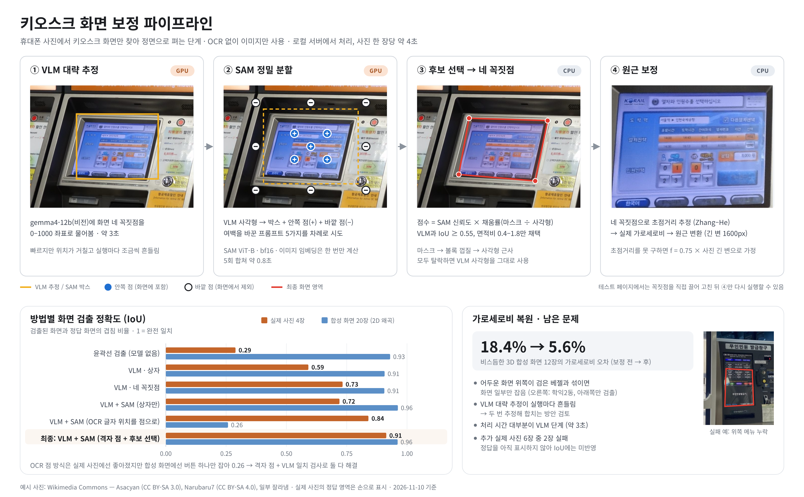

# 키오스크 화면 보정 파이프라인 설명

> 2026-11-10 기준 · 그림: [rectify_pipeline.svg](rectify_pipeline.svg) · 테스트 페이지: https://pub.notpi.uk/cenv/

이 파이프라인은 사진 한 장에서 키오스크 화면의 네 꼭짓점을 찾고, 그 영역을 정면에서 본 직사각형 이미지로 펴는 과정이다. 글자 인식(OCR)은 쓰지 않고 이미지만 다룬다.

- **입력:** 사람이 키오스크 앞에서 찍은 사진. 비스듬하고, 화면 테두리(베젤)와 주변 배경, 반사가 섞여 있다.
- **출력:** 화면만 잘라 정면에서 본 이미지. 원래 화면의 가로세로 비율도 되돌린다.

*그림 1. 같은 사진(공항철도 발매기)에 단계별 결과를 겹쳐 표시. 노란 선은 VLM 추정과 SAM 박스, 파란 점은 안쪽 점(+), 흰 점은 바깥 점(−), 빨간 선은 최종 화면 영역이다. 아래 왼쪽은 방법별 정확도, 아래 오른쪽은 가로세로비 복원 효과와 남은 문제. 원본: [rectify_pipeline.svg](rectify_pipeline.svg)*

---

## 1. 큰 그림: 세 도구의 약점을 서로 메운다

이 문제는 성격이 다른 두 가지로 나뉜다.

1. **무엇이 화면인지 알아보는 것.** 화면, 베젤, 기계 몸체, 옆의 다른 키오스크, 붙은 안내문을 구분하려면 장면을 이해해야 한다.
2. **화면 경계를 정확히 따는 것.** 픽셀 단위로 정확해야 한다.

어느 도구도 둘을 다 잘하지 못해서 셋을 이어 붙였다.

| 도구 | 잘하는 것 | 못하는 것 |
|---|---|---|
| VLM (gemma4-12b, 비전 언어 모델) | 화면이 어디 있는지 알아봄 | 좌표가 거칠고, 실행마다 조금씩 흔들림 |
| SAM (Meta의 Segment Anything 분할 모델) | 힌트만 주면 경계를 정확히 따냄 | 무엇을 따야 하는지는 스스로 모름. 힌트가 조금만 달라도 결과가 크게 바뀜 |
| 기하 계산 (원근 보정) | 네 꼭짓점만 있으면 수학적으로 정확히 폄 | 네 꼭짓점을 누군가 줘야 함 |

흐름을 한 줄로 쓰면: **VLM이 대략 위치를 잡고 → SAM이 경계를 다듬고 → 규칙으로 SAM 결과를 검증하고 → 기하 계산으로 편다.**

학습시킨 모델은 하나도 없다. 사전학습 모델을 그대로 쓰고(zero-shot), 그 위에 규칙과 기하 계산만 더했다.

---

## 2. 단계별 설명

### ① VLM 대략 추정 (GPU, 약 3초)

사진을 gemma4-12b에 그대로 넣고 이렇게 묻는다.

> "키오스크 디스플레이 화면(글자와 버튼이 표시되는 빛나는 영역, 기계 몸체·베젤 제외)의 네 꼭짓점을 0~1000 좌표로, 왼쪽위·오른쪽위·오른쪽아래·왼쪽아래 순서로 숫자만 답하라."

- **0~1000 좌표인 이유:** 사진 크기와 상관없이 쓸 수 있는 정규화 좌표다. VLM은 이런 형식의 좌표에 익숙하다.
- **이 단계가 하는 일:** 무엇이 화면인지 판단한다. 옆 키오스크나 안내문 대신 진짜 화면을 고르는 것도 여기서 한다. 공항철도 사진에서 꺼진 왼쪽 화면 대신 켜진 오른쪽 화면을 고른 게 이 단계다.
- **한계:**
  - 좌표가 거칠다. 대부분 기울어지지 않은 직사각형처럼 답한다.
  - 같은 사진도 인코딩이 조금 다르면 답이 바뀐다.
  - 이 단계만 써도 실제 사진 IoU가 0.73이다. IoU는 찾은 영역과 정답 영역의 겹침 비율이고, 1이면 완전히 일치한다.
- **시간:** 전체 처리 시간의 대부분(약 3초)이 이 단계다.

### ② SAM 정밀 분할 (GPU, 프롬프트 5개 합쳐 약 0.8초)

SAM은 이미지와 힌트(프롬프트)를 받아 해당 물체의 마스크를 돌려주는 분할 모델이다. 힌트로는 박스, 포함할 점, 제외할 점을 줄 수 있다. ViT-B 모델을 Arc GPU에서 bf16으로 돌린다. fp16으로 돌리면 결과가 NaN으로 깨졌다.

**힌트는 VLM 사각형으로 자동 생성한다.**

- **박스:** VLM 사각형을 감싸는 상자에 여백을 조금(2~7%) 더한다. VLM이 화면을 약간 작게 잡아도 SAM이 바깥 경계까지 볼 수 있게 하려는 것이다.
- **안쪽 점 (+) 5개:** VLM 사각형의 중앙과, 가로세로 30%·70% 지점 4곳. "여기는 화면에 포함"이라는 뜻이다.
- **바깥 점 (−) 최대 8개:** VLM 사각형의 네 꼭짓점과 네 변의 중점을 중심에서 1.35배 밖으로 민 위치. "여기는 화면 아님"이라는 뜻이고, 베젤이나 몸체가 섞이지 않게 막는다. 사진 밖으로 나간 점은 버린다.

**프롬프트를 5가지로 바꿔 가며 다 돌린다.** 격자 점 + 박스(여백 4%, 7%) 2개와 박스만(여백 2%, 4%, 7%) 3개다.

- **이유:** SAM은 힌트가 조금만 달라도 결과가 크게 바뀐다. 같은 사진(법원 무인발급기)에서 여백만 바꿨는데 IoU가 0.68과 0.90으로 갈린 적이 있다. 그래서 하나에 걸지 않고 여러 개를 돌린 뒤 고르는 방식으로 바꿨다.
- **비용:** SAM에서 무거운 부분은 사진을 특징으로 바꾸는 이미지 인코더다. 인코더 결과(임베딩)를 캐시해서 사진당 한 번만 계산하고(약 0.2초), 프롬프트마다 가벼운 마스크 디코더만 다시 돌린다(약 0.04초). 그래서 5번 돌려도 싸다.

**SAM은 프롬프트 하나에 마스크 후보를 3개 낸다.** 그중 하나를 이렇게 고른다.

- **점 힌트가 있을 때:** 안쪽 점을 많이 덮고 바깥 점을 적게 덮는 마스크를 고른다. 점수가 같으면 더 작은 마스크를 고른다. 몸체 전체를 화면으로 잡는 것을 막기 위해서다.
- **박스만 있을 때:** SAM 신뢰도 점수와 박스를 채운 정도를 같이 본다.

### ③ 후보 선택 → 네 꼭짓점 (CPU)

②에서 후보가 최대 5개 나온다. 먼저 검증을 통과하지 못한 후보를 버린다.

- **VLM과의 일치:** VLM 사각형과 IoU가 0.55 이상이어야 한다. SAM이 엉뚱한 물체(버튼 하나, 기계 전체)를 잡은 경우를 거르는 장치다.
- **크기:** VLM 사각형 대비 면적이 0.4~1.8배여야 한다.

통과한 후보 중에서는 **점수 = SAM 신뢰도 × 채움률**이 가장 큰 것을 고른다.

- **채움률:** 마스크 면적을 그 마스크에서 뽑은 사각형 면적으로 나눈 값. 화면은 깔끔한 사각형이라 1에 가까워야 한다. 마스크가 들쭉날쭉하거나 엉뚱한 모양이면 값이 낮아진다.

**마스크를 네 꼭짓점으로 바꾸는 방법:**

1. 작은 구멍을 메운다(모폴로지 닫기).
2. 가장 큰 덩어리만 남긴다.
3. 볼록 껍질(convex hull)을 구한다.
4. 다각형 근사 허용치를 조금씩 키우면서 꼭짓점이 정확히 4개가 될 때까지 근사한다.
5. 끝내 4개가 안 되면 마스크를 감싸는 최소 면적 회전 사각형을 쓴다.

**후보가 전부 탈락하면** VLM 사각형을 그대로 쓴다. 결과가 아예 없는 경우는 없게 했다.

### ④ 원근 보정 (CPU)

네 꼭짓점을 직사각형으로 옮기는 변환(호모그래피, 원근 변환)은 OpenCV 함수 하나로 끝난다. 문제는 **결과 직사각형의 가로세로 비율을 모른다는 것**이다.

- **단순한 방법의 문제:** 사진 속 변 길이로 비율을 정하면, 비스듬히 찍었을 때 먼 쪽이 짧아 보여서 화면이 눌린 채로 펴진다. 3D 합성 데이터에서 이 방식의 오차가 18.4%였다.
- **해결: Zhang–He 방법.** 화이트보드 촬영 보정 논문의 방법이다.
  - 실제로는 직사각형인 물체가 원근 때문에 사각형으로 찍혔다고 가정한다.
  - 마주 보는 변을 연장하면 소실점이 2개 생긴다.
  - 이미지 중심이 광학 중심이라고 가정하면, 두 소실점에서 카메라 초점거리를 역산할 수 있다.
  - 초점거리를 알면 실제 가로세로 비율이 계산된다.
  - 오차가 18.4%에서 **5.6%**로 줄었다.
- **초점거리를 못 구하는 경우:** 예를 들어 옆으로만 돌아서 찍으면 위아래 변이 평행이라 소실점이 하나뿐이다. 이때는 일반적인 휴대폰 메인 카메라 값인 **f = 0.75 × 사진 긴 변**을 가정한다. 35mm 환산 약 26mm 화각에 해당한다.
- **출력:** 긴 변 1600px로 편다.

---

## 3. 테스트 페이지에서 볼 수 있는 것 (pub.notpi.uk/cenv)

- **방법 선택:**
  - VLM+SAM: 기본값, 위 파이프라인 전체
  - VLM+SAM(상자): 점 힌트 없음
  - VLM만: ①만 사용
  - 윤곽선: 모델 없이 고전 영상처리만 사용
- **"원래 비율 복원" 토글:** 끄면 변 길이로 비율을 정한다. 켜고 끄면서 ④의 효과를 바로 비교할 수 있다.
- **꼭짓점 끌기와 "이 꼭짓점으로 다시 펴기":** 꼭짓점을 직접 고치면 ④만 다시 실행한다. 검출(①~③)과 보정(④)이 분리돼 있다는 걸 보여주는 기능이기도 하다. 앱에서는 "자동으로 잡고, 틀리면 사용자가 손으로 수정"하는 UX로 쓸 수 있다.
- **결과 정보:** 단계별 소요 시간, 어떤 후보가 채택됐는지, 5개 후보의 점수와 탈락 여부가 나온다.

---

## 4. 평가 방법과 결과

**지표:** IoU(정답 화면 영역과 찾은 영역의 겹침 비율, 1 = 완전 일치)와 가로세로비 오차.

| 데이터 | 구성 | 정답 출처 | 최종 IoU |
|---|---|---|---|
| 합성 2D | 화면 4종(카페·버거·주차·병원) × 왜곡 5종(약한 기울기, 강한 각도, 반사, 어두움·노이즈, 원거리) = 20장 | 생성할 때 알고 있음 | 0.96 |
| 합성 3D | 화면 4종을 가상 카메라로 옆·아래·기울여서 투영한 12장 | 생성할 때 알고 있음 (실제 비율 포함) | 0.87 (비율 오차 5.6%) |
| 실제 사진 | Wikimedia Commons 4장 | 손으로 표시 | 0.91 |

**왜 지금 구조가 됐는지 (실제 사진 4장 IoU 기준, 시도한 순서):**

1. **윤곽선 검출 0.29:** 합성 화면에선 0.93인데 실제 사진에선 배경의 다른 사각형을 잡는다. 그래서 "장면 이해"가 필요하다는 결론이 나왔다.
2. **VLM만 0.73:** 화면은 찾지만 경계가 거칠다.
3. **VLM + SAM(박스만) 0.72:** SAM이 베젤이나 몸체까지 크게 잡아서 오히려 나빠졌다.
4. **VLM + SAM(OCR 글자 위치를 안쪽 점으로) 0.84:** 실제 사진에선 좋아졌다. 그런데 합성 화면에선 0.26으로 무너졌다. 글자 점이 버튼 하나에 몰리면 SAM이 그 버튼만 잘라냈기 때문이다.
5. **최종, VLM + SAM(격자 점 + 5개 프롬프트 + 검증) 0.91:** 점을 화면 전체에 고르게 뿌리고, VLM과 어긋나는 결과를 버리고, 여러 번 시도해서 가장 사각형다운 것을 고르는 방식으로 두 문제를 다 풀었다. 합성 화면도 0.96이다.

---

## 5. 한계와 다음 단계

- **어두운 화면 위쪽 + 검은 베젤:** 경계가 보이지 않으면 SAM이 화면 일부만 잡는다. 예로 학익2동 사진은 아래 절반만 잡았다.
- **VLM 흔들림:** 같은 사진도 실행마다 출발점이 달라진다. 두 번 추정해서 합치는 방안을 생각하고 있다.
- **속도:** 장당 약 4초이고, 그중 3초가 VLM이다. 앱으로 가려면 VLM 단계를 줄이는 게 핵심이다.
- **평가 데이터가 적음:** 실제 사진 정답은 4장뿐이다. 추가한 6장은 정답을 아직 표시하지 않았고, 눈으로 보면 4장 성공, 2장 실패다. 다음 할 일은 정답을 표시해서 지표에 넣는 것이다.

---

## 6. 예상 질문

- **"VLM만 쓰거나 SAM만 쓰면 안 되나?"**
  - VLM만 쓰면 경계가 거칠다(0.73).
  - SAM만으로 자동 분할하면 사진 속 모든 물체가 나와서, 그중 무엇이 화면인지 고를 수단이 없다.
  - 그래서 VLM이 "무엇을", SAM이 "정확히 어디까지"를 맡는다.
- **"학습은 안 했나?"** 안 했다. 데이터가 거의 없는 탐색 단계라, 사전학습 모델 조합과 기하 계산으로 어디까지 되는지 보는 게 목적이다. 실제 사진 데이터가 쌓이면 가벼운 꼭짓점 검출 모델을 학습해서 VLM 단계를 대체하는 방향도 있다.
- **"왜 로컬 서버인가?"**
  - 외부 AI API를 쓰면 사진 한 장마다 토큰 비용이 나온다.
  - 사진이 외부로 나가지 않아서 개인정보 측면에서도 유리하다.
  - GPU 하나(Intel Arc B50, 16GB)에 VLM과 SAM을 같이 올렸다. SAM 쪽에는 메모리가 부족하면 CPU로 넘기는 보호 장치를 달았다.
- **"비율 복원은 어떤 가정에 기대나?"** 세 가지다.
  - 화면이 실제로 평평한 직사각형이다.
  - 이미지 중심이 광학 중심이다.
  - 픽셀이 정사각형이다.

  휴대폰 사진이면 대체로 맞는 가정이다. 소실점이 하나뿐이면 초점거리를 가정값으로 쓴다.
- **"OCR을 왜 안 쓰나?"** 글자 위치를 SAM 힌트로 써 봤는데, 합성 화면에서 실패했다(0.26). 이미지 보정 단계는 이미지만으로 끝나게 분리했다. OCR은 보정된 화면 위에서 그다음 단계로 돌린다.
